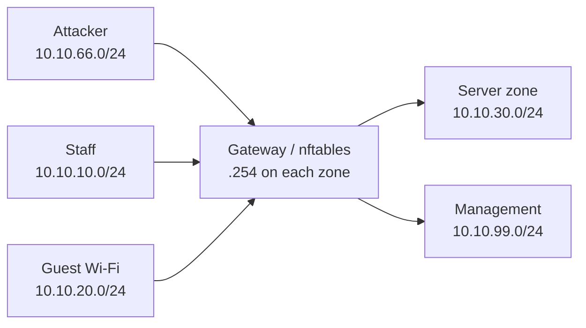

# ClinicGuard architecture

ClinicGuard models five trust zones connected through a Linux gateway:

The gateway is the intended routing and enforcement point. Each Docker network
is marked `internal: true` so the lab does not accidentally provide a direct
external path that bypasses the gateway.

## Initial access policy

| Source | Destination | Policy |
| --- | --- | --- |
| Staff | EHR | Allow the Phase 3 test endpoint on TCP 8080; HTTPS/TCP 443 follows |
| Staff | Internet/DNS | Allow DNS, HTTP, HTTPS |
| Guest | Internet/DNS | Allow DNS, HTTP, HTTPS |
| Guest | Staff, server, management | Deny |
| Attacker | Internal zones | Deny and alert |
| Management | All zones | Read-only monitoring access |

The Phase 3 policy implements default deny and allows only the explicitly
listed flows. The temporary HTTP endpoint is a routing-policy test fixture;
the EHR will move behind TLS in the next phase.
