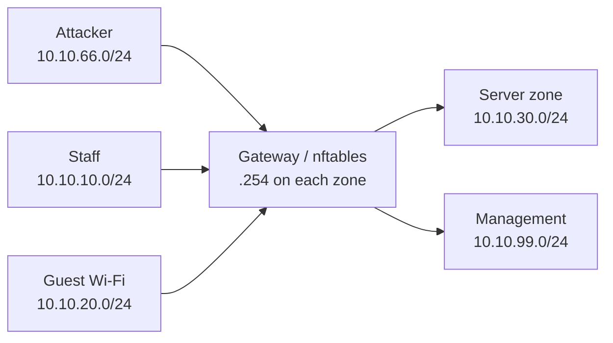

# ClinicGuard architecture

ClinicGuard models five trust zones connected through a Linux gateway:

The gateway is the intended routing and enforcement point. Each Docker network
is marked `internal: true` so the lab does not accidentally provide a direct
external path that bypasses the gateway.

## Initial access policy

| Source | Destination | Policy |
| --- | --- | --- |
| Staff | Gateway EHR proxy | Allow HTTPS/TCP 443 only |
| Staff | Internet/DNS | Allow DNS, HTTP, HTTPS |
| Guest | Internet/DNS | Allow DNS, HTTP, HTTPS |
| Guest | Staff, server, management | Deny |
| Attacker | Internal zones | Deny and alert |
| Management | All zones | Read-only monitoring access |

The Phase 4 policy implements default deny and allows staff to reach only the
gateway's HTTPS reverse proxy. The gateway reaches the EHR through its
server-zone interface. This application-layer boundary is used because Docker
Desktop isolates `internal: true` bridge networks before packets can reach a
container router; removing `internal: true` would create a bypass.

Suricata shares the gateway network namespace so it can inspect the gateway's
zone interfaces. Its local rules alert on guest-to-server HTTPS probes and
attacker TCP probes.
